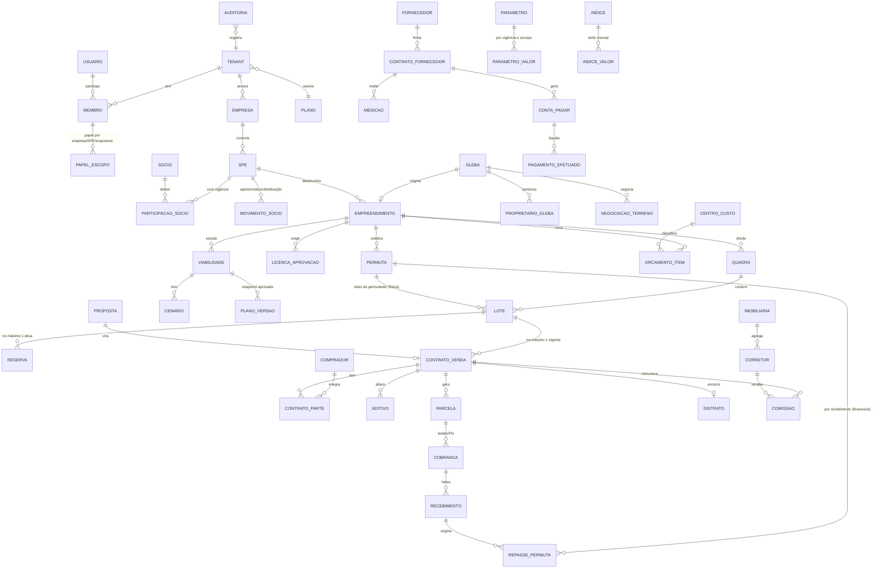

# NorteIA Loteamento — Arquitetura

> Status: **proposta para aprovação** (v0.2, 07/11/2026). Nenhum código de aplicação foi escrito.
> As decisões de produto D-001 a D-010 estão em `docs/decisoes.md`; regras de negócio em `docs/dominio.md`.

---

## 1. Princípios que guiam o desenho

1. **Um único fluxo de caixa é a fonte da verdade.** Todo indicador (TIR, VPL, payback, exposição, necessidade de aporte, retorno por sócio, repasse ao permutante) é *derivado* de lançamentos mensais com data real. Nenhum indicador é digitado ou armazenado como dado de entrada.
2. **O motor financeiro é puro.** Recebe dados, devolve resultados. Não acessa banco, rede, relógio nem variáveis globais. Isso o torna testável, auditável e reutilizável (web, workers, portais, IA, futuros apps NorteIA).
3. **Parâmetros, não constantes.** Alíquotas, índices, percentuais de distrato, multas, juros de mora e regras de permuta vivem em tabelas com vigência e escopo (plataforma → empresa → empreendimento → contrato). O código não conhece números legais.
4. **Isolamento de dados no banco, não só na aplicação.** Row Level Security em 100% das tabelas com dados de cliente; testes automatizados de RLS.
5. **Auditoria por construção.** Gatilhos no banco registram toda alteração; a aplicação não consegue "esquecer" de auditar.
6. **Fornecedores atrás de interfaces.** Pagamentos, assinatura, mensagens, ERP e IA entram por *portas* (interfaces) com *adaptadores* trocáveis.
7. **Simples para o pequeno, completo para o médio.** O mesmo modelo de dados atende os dois; funcionalidades são ligadas por plano, e o pequeno vê padrões sensatos (1 empresa, 1 SPE implícita, sem sócios) sem precisar configurar nada.

---

## 2. Stack proposta

| Camada | Escolha | Justificativa |
| --- | --- | --- |
| Monorepo | **pnpm workspaces + Turborepo** | Isola o motor como pacote próprio, com testes e versão; cache de build/teste. |
| Linguagem | **TypeScript estrito** em tudo | Um só idioma de domínio do banco à tela; tipos gerados do Postgres. |
| Web | **Next.js (App Router) + React** | Server Components e Server Actions reduzem API boilerplate; SSR bom para portais públicos (comprador, sócio); deploy simples na Vercel. Mantenho sua preferência. |
| UI | **Tailwind + shadcn/ui (Radix)** | Componentes acessíveis (teclado, ARIA) que ficam no nosso código, sem lock-in. |
| Formulários / validação | **React Hook Form + Zod** | Os mesmos esquemas Zod validam no cliente, no servidor e nas Edge Functions. |
| Dados no cliente | **TanStack Query** (apenas onde houver interatividade intensa: mapa, simulador) | Cache e atualização otimista do mapa de lotes. |
| Banco | **Supabase Postgres 17 + PostGIS** | Relacional, transacional, RLS nativo; PostGIS para glebas e geometria de lotes. |
| Auth | **Supabase Auth** (e-mail + senha, link mágico, OTP por SMS/WhatsApp para comprador) | Integra com RLS via `auth.uid()` e claims customizados. |
| Arquivos | **Supabase Storage** (buckets privados, URLs assinadas) | Documentos, notas, contratos, KML. Políticas de acesso por tenant. |
| Rotinas | **pg_cron + pgmq (fila no Postgres) + Edge Functions** | Reajuste, régua de cobrança, conciliação, importação de índices. Fila no próprio banco = sem infraestrutura extra, com reentrega e idempotência. |
| Dinheiro | **`bigint` em centavos no banco; `decimal.js` no motor** | Ver §6.1. Nunca `float`. |
| Mapas | **MapLibre GL** para glebas (vetorial, sem custo de licença) + **SVG** para a planta de lotes | MapLibre lida melhor com muitos polígonos e estilos que Leaflet; a planta em SVG é leve no celular e permite cor por status. |
| KML/KMZ | `@tmcw/togeojson` + `jszip` | Conversão para GeoJSON → PostGIS. |
| Gráficos | **Recharts** (ou ECharts se o volume pedir) | Suficiente para fluxo de caixa, curva de exposição e sensibilidade. |
| PDF | **React-PDF** no servidor para extratos/informes; modelos de contrato em **DOCX com placeholders** (`docx-templates`) | O loteador e o advogado editam o modelo no Word. |
| Testes | **Vitest** (motor e domínio, cobertura 100% no motor), **pgTAP** (RLS, gatilhos, funções SQL), **Playwright** (fluxos ponta a ponta) | Cada camada testada onde o erro nasce. |
| Observabilidade | **Sentry** + logs estruturados nas Edge Functions + tabela `job_execucao` | Saber quando a régua ou a conciliação falha. |
| Hospedagem | **Vercel** (web) + **Supabase região `sa-east-1` (São Paulo)** | Latência e residência de dados no Brasil (LGPD). Projeto `krmfljdyzuiipfsfpqvn`, organização Pro (D-001). |

**Por que não um backend separado (NestJS etc.) agora:** o volume (até ~3.000 lotes por empreendimento, dezenas de milhares de parcelas por cliente) cabe com folga no Postgres + Server Actions. A camada de *aplicação* (casos de uso) fica em pacote próprio (§3), então extrair um serviço depois é mudar o transporte, não a regra.

**Ponto de atenção — Edge Functions rodam em Deno.** O motor e o domínio serão escritos sem dependências de Node (apenas `decimal.js` e `zod`, ambos compatíveis), e o build gera ESM consumível pelas duas runtimes. Isso é testado no CI.

---

## 3. Estrutura do repositório

```
norteia-loteamento/
├── apps/
│   └── web/                      # Next.js: painel do loteador, portais (comprador, sócio, permutante)
│       ├── app/(loteador)/...    # desktop-first: configuração e lançamentos
│       ├── app/(campo)/...       # mobile-first: painel, mapa, reserva
│       ├── app/(portal)/...      # comprador, sócio, permutante (somente leitura + 2ª via)
│       └── server/               # Server Actions finas → chamam packages/aplicacao
├── packages/
│   ├── motor-financeiro/         # PURO. Fluxo de caixa, TIR/XIRR, VPL, payback, Price/SAC,
│   │                             # reajuste, distrato, permuta, estresse, valor presente da carteira
│   ├── dominio/                  # Entidades, invariantes, máquinas de estado (lote, contrato, parcela),
│   │                             # esquemas Zod, tipos. Sem I/O.
│   ├── aplicacao/                # Casos de uso: "vender lote", "registrar pagamento", "projetar fluxo".
│   │                             # Orquestra repositórios + motor + portas. Recebe dependências injetadas.
│   ├── projecao/                 # Traduz registros do banco → lançamentos do fluxo (com origem). Ver §5.
│   ├── integracoes/              # Portas (interfaces) + adaptadores: asaas, clicksign, d4sign,
│   │                             # whatsapp, email, bcb-indices, contabil
│   ├── db/                       # Tipos gerados do Supabase, repositórios, cliente
│   └── ui/                       # Componentes compartilhados (formatos BRL, datas, planta SVG)
├── supabase/
│   ├── migrations/               # SQL versionado (única forma de mudar o schema)
│   ├── functions/                # Edge Functions: webhooks, workers de fila, cron
│   ├── tests/                    # pgTAP: RLS, auditoria, travas
│   └── seed/                     # Empreendimento de demonstração (caso de referência)
└── docs/                         # arquitetura, domínio, roadmap, decisões, pendências legais
```

Regra de dependência (verificada por lint, `eslint-plugin-boundaries`):
`motor-financeiro` ← `dominio` ← `projecao` ← `aplicacao` ← `apps/*` / `supabase/functions`.
O motor não importa nada do projeto. Integrações só são importadas pela aplicação, através das interfaces.

---

## 4. Módulos (mapeados ao escopo)

| # | Módulo | Responsabilidade | Fase |
| --- | --- | --- | --- |
| M0 | **Plataforma** | Tenants, planos, funcionalidades por plano, usuários, papéis, convites, auditoria, parâmetros globais (índices, tributos) | 1 |
| M1 | **Prospecção** | Glebas (PostGIS), importação KML/KMZ, funil, proprietários, negociação, forma de pagamento do terreno | 1 (cadastro básico) / 4+ (funil) |
| M2 | **Viabilidade** | Premissas, cenários, sensibilidade, estresse; gera um *plano* (fluxo projetado versionado) | 2 |
| M3 | **Estrutura societária** | Empresas, SPEs, sócios, participações com vigência, aportes, mútuos, distribuições, patrimônio de afetação | 1 (cadastro) / 6 (fluxos) |
| M4 | **Custos e obra** | Plano de contas, orçamento original/revisado, contratos de fornecedor, medições, comprometido, pago, projetado, rateio | 3 |
| M5 | **Comercial** | Planta/mapa, estados do lote, reserva com prazo, proposta, simulador, corretores, imobiliárias, comissões, metas, leads simples | 4 |
| M6 | **Contratos** | Modelos, geração, assinatura eletrônica, aditivos, cessão, quitação, escritura | 5 |
| M7 | **Carteira e cobrança** | Parcelas, Price/SAC, reajuste, encargos de mora, boleto/Pix, conciliação, régua, renegociação, antecipação | 5 |
| M8 | **Distrato** | Simulação e execução parametrizada (art. 32-A da Lei 6.766), devolução parcelada, retorno ao estoque | 6 |
| M9 | **Permutas** | Física (lotes reservados, valor econômico) e financeira (% sobre VGV ou recebido, repasse por parcela, extrato) | 6 |
| M10 | **Inteligência financeira** | Painéis por empreendimento/SPE/sócio/consolidado, plano × realizado + projetado, estresse, cessão de carteira | 2 (base) / 6 (completo) |
| M11 | **Portais** | Comprador, sócio, permutante | 7 |
| M12 | **Fiscal e contábil** | Tributos por regime e vigência (inclui IBS/CBS), DIMOB, informe de IR, exportação contábil, visão caixa × competência | 2 (parâmetros) / 7 |
| M13 | **IA** | Leitura de documentos, perguntas em linguagem natural, alertas — sempre via ferramentas que chamam o motor | 8 |

---

## 5. O coração: fluxo de caixa único

### 5.1 Lançamento de fluxo

Todo valor que entra ou sai é um **lançamento** com os atributos exigidos pelas regras de negócio:

```
Lancamento {
  data: Date                     // data real (vencimento, pagamento, previsão)
  competencia: 'AAAA-MM'         // mês de agregação
  tenantId, empresaId, speId, empreendimentoId
  centroCustoId                  // plano de contas (terreno, infraestrutura.drenagem, comercial.comissao...)
  natureza: 'realizado' | 'comprometido' | 'carteira' | 'projetado'
  categoria: 'receita_imobiliaria' | 'receita_juros' | 'custo' | 'tributo'
           | 'aporte' | 'distribuicao' | 'mutuo' | 'repasse_permuta' | 'devolucao_distrato' ...
  valor: Centavos                // sinal: + entrada, − saída (ótica do empreendimento)
  origem: { tipo: 'parcela' | 'pagamento' | 'contrato_fornecedor' | 'medicao'
                 | 'premissa_viabilidade' | 'distrato' | ..., id: uuid }
  cenario?: id                   // para projetados
}
```

A separação **receita imobiliária × receita de juros** é feita na própria parcela (amortização vs. juros da tabela Price/SAC), e o reajuste por índice fica em categoria própria. Assim o painel mostra lucro imobiliário e receita financeira separados sem recalcular nada.

### 5.2 Como o fluxo é montado (camada `projecao`)

```
 Registros do banco                   projecao                       motor-financeiro
┌───────────────────────┐   ┌──────────────────────────┐   ┌──────────────────────────────┐
│ pagamentos recebidos  │──►│ realizado                │   │                              │
│ contas pagas          │──►│ realizado                │   │  agrega por mês              │
│ contratos fornecedor  │──►│ comprometido (saldo)     │──►│  aplica estresse/cenário     │
│ parcelas a vencer     │──►│ carteira (× (1−inad.))   │   │  TIR, XIRR, VPL, payback,    │
│ orçamento não contrat.│──►│ projetado                │   │  exposição, necessidade de   │
│ estoque × velocidade  │──►│ projetado (vendas)       │   │  aporte, rateio por sócio,   │
│ parâmetros tributários│──►│ tributos sobre entradas  │   │  repasse a permutante        │
└───────────────────────┘   └──────────────────────────┘   └──────────────────────────────┘
```

Regras da montagem:
- **Sem dupla contagem:** o orçamento de uma etapa vira *projetado* só pelo saldo não contratado; o contrato vira *comprometido* só pelo saldo não pago; o pago é *realizado*. Orçado = realizado + comprometido + projetado, sempre (invariante testado).
- **Permuta física:** os lotes do permutante saem do estoque vendável e o terreno entra com o custo efetivamente desembolsado; o valor econômico da permuta é informação gerencial/fiscal, não saída de caixa. **[VALIDAR COM CONTADOR o tratamento contábil.]**
- **Datas reais:** o fluxo guarda datas; a agregação mensal é feita no motor. XIRR usa as datas; TIR mensal usa os meses.

### 5.3 Persistência

- **Realizado** é persistido como dado (é fato: pagamento, baixa).
- **Comprometido, carteira e projetado** são calculados sob demanda a partir dos registros (são consequência). Para desempenho do painel consolidado, o resultado do motor fica em cache (`resultado_fluxo_cache`) invalidado por gatilho quando qualquer registro de origem do empreendimento muda.
- **Plano original (baseline):** ao aprovar uma viabilidade, o sistema grava um **snapshot imutável** do fluxo projetado e das premissas (`plano_versao`). O painel compara esse snapshot com *realizado + projetado atual*. Revisões (re-baseline) só pelo papel `dono`, com justificativa obrigatória; cada revisão é uma nova `plano_versao` e a original nunca é apagada — o painel mostra original × última revisão × realizado+projetado (D-006).
- **Base monetária:** projeções em **valores reais** (moeda da data-base) com TMA real, por padrão; visão nominal opcional aplica premissa de inflação ao fluxo e exige TMA nominal. O motor recusa combinar fluxo real com taxa nominal e vice-versa (D-005).

### 5.4 API do motor (esboço de assinaturas, não implementação)

```ts
projetarFluxo(entrada: EntradaFluxo): FluxoMensal
indicadores(fluxo: FluxoMensal, opcoes: { tmaMensal: Taxa }): Indicadores
  // vgvVendido, recebido, custos, tributos, lucroNominal, tirMensal, tirAnual,
  // xirr, vpl, exposicaoMaxima{valor, mes}, paybackSimples, paybackDescontado,
  // margemSobreVgv, retornoSobreCapitalProprio, necessidadeAporte[mes]
estressar(entrada: EntradaFluxo, choques: Choque[]): EntradaFluxo
sensibilidade(entrada, eixoX: Variavel, eixoY: Variavel): Matriz
tabelaPrice / tabelaSac(principal, taxa, n, dataPrimeira): Parcela[]
reajustar(parcelas, serieIndice, regraAniversario): Parcela[]
encargosMora(parcela, dataPagamento, regra): Encargos
simularDistrato(contrato, pagamentos, parametros, data): ResultadoDistrato
repassePermuta(recebimento, regraPermuta): Repasse
valorPresenteCarteira(parcelas, taxa, curvaInadimplencia): Centavos
ratearPorSocio(fluxo, participacoesComVigencia): FluxoPorSocio
```

Tudo determinístico: a data de referência ("hoje") é **parâmetro**, nunca `new Date()`.

---

## 6. Decisões técnicas de fundo

### 6.1 Dinheiro e taxas
- Banco: `bigint` em **centavos** para valores; taxas e índices em `numeric(20,10)`.
- Motor: `decimal.js` com 34 dígitos significativos nas contas intermediárias (Price com 120 parcelas, descontos de VPL); arredondamento **half-even para centavos apenas na fronteira** (ao gerar a parcela que será cobrada, ao exibir, ao persistir).
- Parcelas: diferença de arredondamento da tabela Price vai para a **última parcela**, para que a soma dos principais feche exatamente com o financiado.
- Tipos marcados (`Centavos`, `Taxa`) impedem somar dinheiro com taxa por engano no TypeScript.

### 6.2 Tempo
- Datas de negócio em `date` (sem fuso); instantes de auditoria em `timestamptz`. Fuso de exibição `America/Sao_Paulo`.
- "Mês 0" de um empreendimento = competência da data-base da viabilidade.

### 6.3 Cálculo de TIR
- TIR mensal por Newton-Raphson com fallback para bisseção (robusto a fluxos com várias trocas de sinal); quando houver mais de uma raiz, o motor sinaliza `tirMultipla: true` em vez de escolher silenciosamente.
- TIR anual = (1 + TIR mensal)^12 − 1. XIRR com base 365 dias.

---

## 7. Modelo de dados (entidades e relações)

Todas as tabelas de cliente têm `tenant_id`, `criado_em`, `criado_por`, `atualizado_em`, `atualizado_por`. Chaves `uuid`. Chaves estrangeiras **compostas com `tenant_id`** (`(tenant_id, empreendimento_id)`) — o banco impede, por construção, que um registro aponte para dado de outro cliente.



Entidades de apoio não desenhadas: `documento` (polimórfico, Storage), `lead`, `meta_comercial`, `modelo_contrato`, `regua_cobranca`/`regua_etapa`, `mensagem_enviada`, `webhook_recebido` (idempotência), `job_execucao`, `lancamento_manual` (ajustes de caixa com justificativa), `regime_tributario_vigencia` por SPE.

### 7.1 Máquinas de estado (no domínio e reforçadas no banco)

- **Lote:** `disponivel → reservado → vendido`; `disponivel ↔ bloqueado`; `permuta` (fixo); `vendido → disponivel` apenas via distrato concluído.
- **Contrato de venda:** `rascunho → aguardando_assinatura → vigente → (quitado | distratado | cedido)`.
- **Parcela:** `prevista → emitida → (paga | paga_parcial | vencida) → renegociada | cancelada`.

### 7.2 Travas críticas no banco
- **Venda duplicada:** índice único parcial `(lote_id) WHERE status IN ('ativa')` em reserva e `(lote_id) WHERE status IN ('vigente','aguardando_assinatura')` em contrato; a transição é feita por função SQL `reservar_lote()` / `vender_lote()` com `SELECT … FOR UPDATE` no lote. Dois corretores clicando ao mesmo tempo: um vence, o outro recebe erro claro.
- **Reserva com prazo:** `expira_em`; job a cada minuto libera reservas vencidas (e a leitura já trata reserva expirada como inexistente, para não depender do job).
- **Venda antes do registro:** `vender_lote()` recusa se o empreendimento não tiver `registro_loteamento` com data; liberação só por usuário com permissão específica, com justificativa obrigatória gravada em auditoria. **[VALIDAR COM ADVOGADO se a exceção deve existir ou apenas o bloqueio.]**

---

## 8. Multiempresa e isolamento

Hierarquia: **Tenant (cliente da NorteIA)** → Empresas → SPEs → Empreendimentos.

- **Tenant** é a unidade de cobrança e de isolamento. Um grupo loteador com 3 empresas e 7 SPEs é *um* tenant.
- **Usuário** é global (Supabase Auth). **Membro** liga usuário a tenant; um mesmo usuário pode ser membro de vários tenants (ex.: contador, corretor parceiro, sócio investidor em dois grupos). Corretor parceiro acessa vários loteadores com o mesmo login. Login é **próprio deste produto**; cada pessoa recebe um `pessoa_global_id` estável para permitir unificar o login da família NorteIA no futuro sem migração destrutiva (D-003).
- **Papéis com escopo:** `dono`, `financeiro`, `engenharia`, `comercial_gestor`, `corretor`, `contador`, `socio_leitura`, `permutante_leitura`, `comprador`. Cada papel é atribuído em um escopo (tenant inteiro, empresa, SPE ou empreendimento). Corretor vê só lotes, reservas e suas comissões; sócio vê só as SPEs em que participa.
- **RLS:** função `auth_tem_acesso(tenant_id, escopo_id, permissao)` em `security definer`, apoiada em tabela de permissões materializada por usuário (rápida). O tenant ativo vai num claim do JWT (Custom Access Token Hook), mas a verificação **sempre** consulta a tabela de membros — o claim é só seleção, não autorização.
- **Service role** usada apenas em Edge Functions de sistema (webhooks, jobs), que *sempre* filtram por tenant e gravam `executado_por = 'sistema:<job>'`.
- **Testes pgTAP obrigatórios:** para cada tabela, um usuário do tenant A não lê, não insere, não altera e não apaga dados do tenant B. O CI falha se surgir tabela sem política (consulta a `pg_policies`).
- **Funcionalidades por plano:** tabela `plano_funcionalidade` (ex.: `permuta_financeira`, `multi_spe`, `cobranca_automatica`, `portal_socio`, `ia`), limites (`max_lotes_gerenciados`) e função `tem_funcionalidade(tenant, chave)` usada na UI, nas Server Actions e, para dados sensíveis, nas políticas.

---

## 9. Auditoria e segurança

### 9.1 Trilha de auditoria
- Gatilho genérico `auditar()` em todas as tabelas de negócio grava em `auditoria`: tabela, id, operação, `antes` (jsonb), `depois` (jsonb), diferença calculada, usuário (`auth.uid()`), tenant, instante, `request_id` e `motivo` (quando a operação exige justificativa — enviado via `set_config('app.motivo', …)` na transação).
- `auditoria` é **somente inserção**: sem `UPDATE`/`DELETE` para nenhum papel; particionada por mês.
- Exclusão de registros financeiros é **lógica** (`cancelado_em`, `cancelado_por`, `motivo`). Parcela paga nunca é apagada; correções são lançamentos de estorno.
- Mudança de parâmetro com vigência nunca sobrescreve: cria nova vigência.

### 9.2 Segurança e LGPD
- Dados pessoais (CPF, RG, endereço, renda) em tabelas separadas com política de acesso mais restrita; acesso a dados sensíveis também é auditado (leitura).
- Storage com buckets privados por tenant e URLs assinadas de curta duração.
- Segredos de integração por tenant (chave Asaas, token de assinatura) cifrados com **Supabase Vault**, nunca expostos ao navegador.
- Webhooks: verificação de assinatura/token do provedor + tabela de idempotência (`provedor`, `evento_id` único).
- Portal do comprador: login por CPF + código enviado por e-mail/WhatsApp; nada de senha fraca reaproveitada.
- MFA obrigatório para papéis `dono` e `financeiro` (Supabase Auth TOTP).
- Backups do Supabase (PITR no plano pago) + exportação lógica semanal para bucket separado.

---

## 10. Integrações (portas e adaptadores)

| Porta | Métodos principais | Adaptador inicial | Futuro |
| --- | --- | --- | --- |
| `GatewayCobranca` (conta Asaas **do próprio loteador**, chave por tenant no Vault — D-004) | `criarCliente`, `emitirCobranca` (boleto+Pix), `cancelar`, `consultar`, `interpretarWebhook` | **Asaas** | Inter, Sicoob, Itaú (CNAB/API) |
| `AssinaturaEletronica` | `criarEnvelope`, `adicionarSignatario`, `status`, `baixarAssinado`, `interpretarWebhook` | **Clicksign** | D4Sign |
| `Mensageria` | `enviarTemplate`, `status`, `interpretarWebhook` | WhatsApp **Cloud API oficial (Meta)** (D-009) + e-mail (Resend) | — |
| `FonteIndices` | `serie(codigo, de, ate)` | **BCB SGS** (IPCA 433, IGP-M 189, INCC-M 192 — códigos a confirmar na implementação) | IBGE/FGV direto |
| `ExportacaoContabil` | `exportarLancamentos(periodo, layout)` | CSV/TXT genérico configurável | Domínio, Alterdata, Omie |
| `ProvedorIA` | `extrairDocumento`, `responderComFerramentas` | Claude (Anthropic API) | — |

O domínio só conhece as portas. Cada adaptador tem testes de contrato contra respostas gravadas (fixtures) e um **adaptador falso** usado em desenvolvimento e no ambiente de demonstração — dá para demonstrar cobrança e assinatura sem conta real.

---

## 11. Rotinas assíncronas

| Rotina | Gatilho | Observações |
| --- | --- | --- |
| Importar índices | diário (pg_cron) | Grava série; reajuste só usa índice **publicado** (sem estimativa). |
| Reajuste de parcelas | diário, por data de aniversário | Gera aditivo técnico + auditoria; idempotente por (contrato, competência). |
| Emissão de cobranças | diário, N dias antes do vencimento (parâmetro) | Via `GatewayCobranca`. |
| Conciliação | webhook (principal) + varredura diária (rede de segurança) | Baixa parcela, calcula encargos, gera lançamento realizado, dispara repasse de permuta. |
| Régua de cobrança | diário | Etapas configuráveis (D−3, D0, D+3, D+15…), canal, modelo; respeita opt-out. |
| Liberar reservas vencidas | a cada minuto | |
| Recalcular cache de indicadores | fila, por empreendimento alterado | Debounce para não recalcular a cada clique. |

Todos os jobs passam por `pgmq` com reentrega, registram `job_execucao` e alertam (Sentry/e-mail) após falhas repetidas.

---

## 12. Frontend

- **Mobile first** (rotas `(campo)` e `(portal)`): painel do dono, planta de lotes com cores por status, reserva em 3 toques, simulador de parcelas, segunda via de boleto/Pix. Testadas em 360 px de largura.
- **Desktop first** (rotas `(loteador)`): configuração, viabilidade com tabela de premissas, lançamentos de custo, conciliação.
- **PWA** instalável para o corretor e o comprador (sem app nativo nesta etapa).
- Formatação centralizada: `Intl.NumberFormat('pt-BR', { style: 'currency', currency: 'BRL' })`, datas `dd/MM/aaaa`, percentuais com vírgula. Entrada de valores aceita "1.234,56".
- Toda tela que mostra número financeiro tem rótulo explícito de natureza: **Vendido (VGV)**, **Recebido**, **A receber (carteira)**, **Resultado** — nunca "faturamento" genérico.
- **Modo planilha para o pequeno loteador:** onboarding guiado em uma tela (nº de lotes, preço, prazo, custos principais) que já gera viabilidade e o empreendimento; o resto é progressivo.

---

## 13. IA (fase 8, desenho reservado agora)

- A IA opera **apenas por ferramentas** (`consultar_indicadores`, `listar_inadimplentes`, `projetar_aporte`…) que chamam `packages/aplicacao` com as permissões do usuário que pergunta. Ela não recebe acesso SQL livre e não calcula indicadores — explica o que o motor devolveu, citando a origem.
- Leitura de notas/recibos gera **sugestão de lançamento** que o usuário confirma; nada é lançado sozinho.

---

## 14. Ambientes, qualidade e entrega

- **Ambientes:** `local` (Supabase CLI em Docker), `preview` (branch do Supabase por PR, se o plano permitir), `staging` (com o empreendimento de demonstração) e `producao`. **Projeto Supabase novo e exclusivo** — nenhum outro projeto seu será tocado.
- **CI (GitHub Actions):** lint, typecheck, Vitest (motor com limiar de cobertura 100% em linhas e ramos), pgTAP, build, Playwright nos fluxos críticos (reservar, vender, receber, distratar).
- **Migrations** só por arquivo versionado; nada de alterar schema pelo painel.
- **Commits** pequenos, em português, no padrão `tipo(escopo): descrição` (ex.: `feat(motor): calcula payback descontado`).
- **Documentos vivos:** `docs/decisoes.md` (ADRs curtos), `docs/pendencias-legais.md` (tudo marcado `VALIDAR COM CONTADOR/ADVOGADO`).

---

## 15. Validação prévia do caso de referência

Antes de propor o motor, reproduzi o caso de teste do enunciado num protótipo descartável (script fora do repositório, não é código da aplicação) para confirmar que as premissas são internamente consistentes e para fixar as convenções que o motor precisa seguir. **Todos os valores batem**, inclusive os quatro testes de estresse:

| Indicador | Esperado | Protótipo |
| --- | --- | --- |
| Total recebido | R$ 11.154.525 | R$ 11.154.525,48 |
| Custos | R$ 4.893.000 | R$ 4.893.000,00 |
| Tributos | R$ 661.463 | R$ 661.463,36 |
| Lucro nominal | R$ 5.600.062 | R$ 5.600.062,12 |
| TIR mensal / anual | 1,48% / 19,3% | 1,4814% / 19,30% |
| VPL a 1,2% a.m. | R$ 515.116 | R$ 515.115,69 |
| Exposição máxima | R$ 3.447.951 no mês 30 | R$ 3.447.951,42 no mês 30 |
| Payback simples / descontado | mês 76 / mês 115 | 76 / 115 |
| Estresse: 2 lotes/mês · infra 3,45 mi · inad. 15% · preço 81 mil | 15,3% · 16,6% · 16,9% · 16,2% | 15,26% · 16,56% · 16,86% · 16,22% |

Convenções confirmadas (viram regras do motor e entram no `docs/dominio.md`):
1. Fluxo indexado do **mês 0**; o mês 0 não é descontado no VPL.
2. Tributo incide sobre **todo** valor recebido (entrada + parcelas efetivamente recebidas), no mês do recebimento.
3. Inadimplência aplicada como redução proporcional de cada parcela (não como parcelas inteiras perdidas); a entrada não sofre inadimplência.
4. Comissão sai no mês da venda, sobre o valor do lote.
5. **Payback** = primeiro mês em que o saldo acumulado (simples ou descontado à TMA) fica ≥ 0 após ter sido negativo.
6. **Exposição máxima** = menor saldo acumulado do fluxo (valor absoluto) e o mês em que ocorre.
7. Cálculo sem arredondamento intermediário; com arredondamento das parcelas a centavos, as diferenças ficam dentro das tolerâncias (será verificado no teste definitivo).

---

## 16. Situação das decisões

Todas as decisões que estavam abertas foram tomadas em 07/11/2026 (D-003 a D-010, `docs/decisoes.md`). Ainda falta a aprovação deste documento, de `docs/dominio.md` e de `docs/roadmap.md`.
